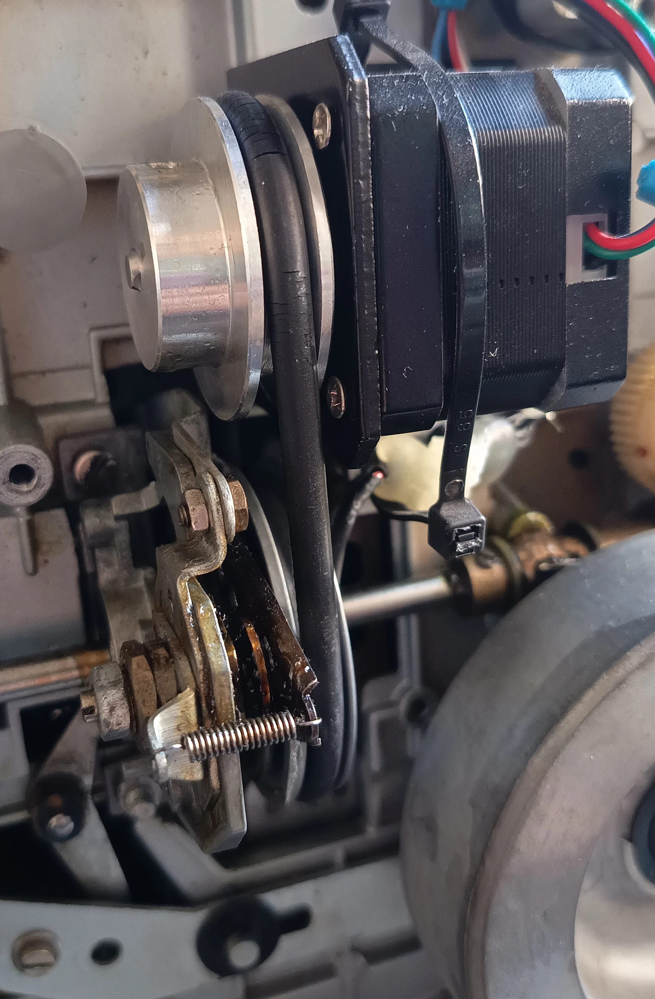
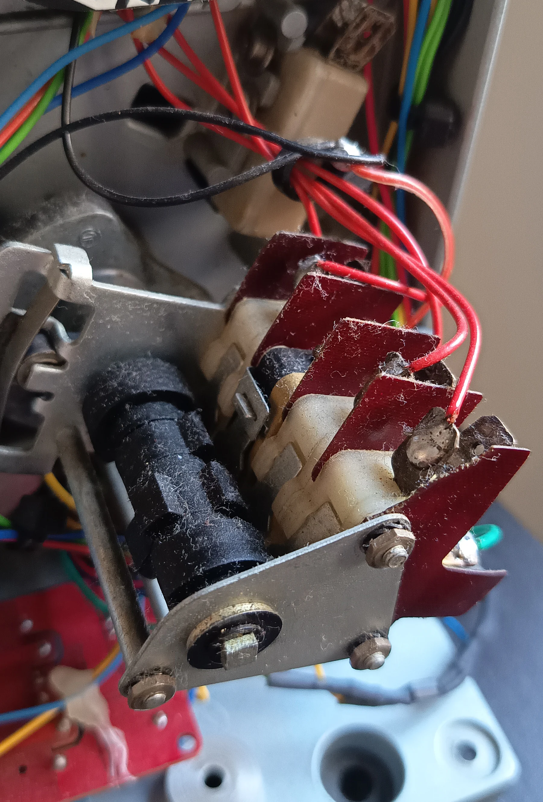
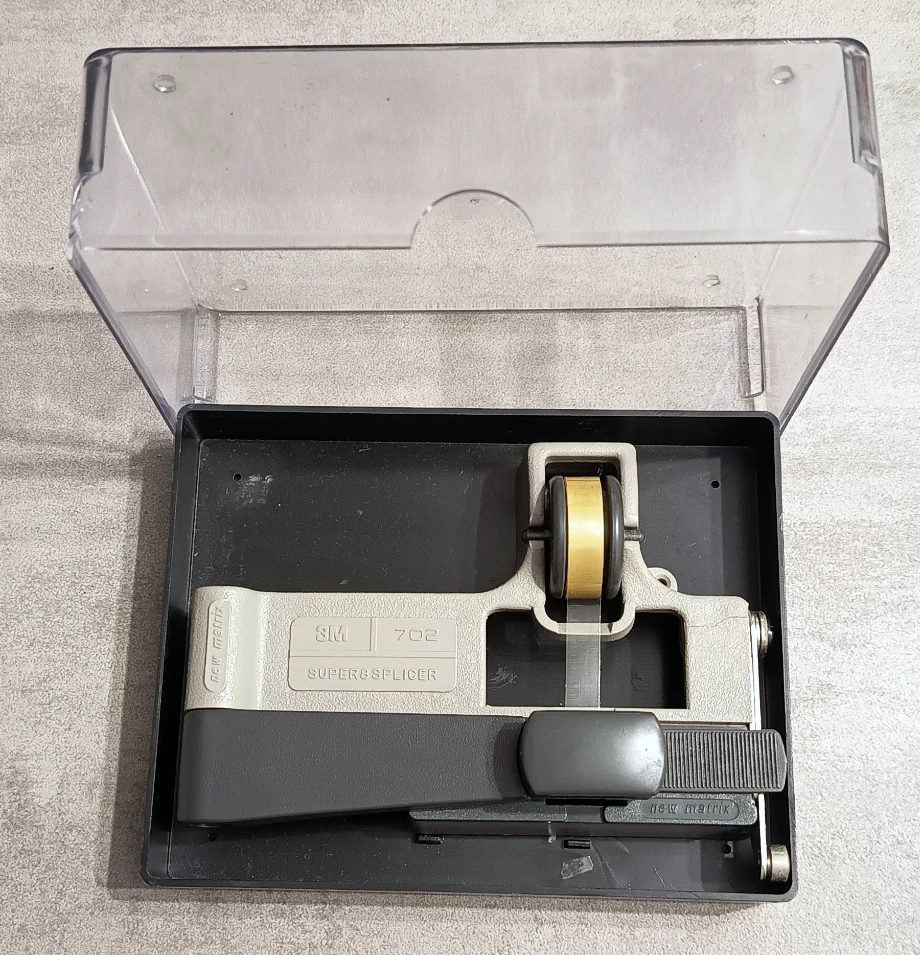
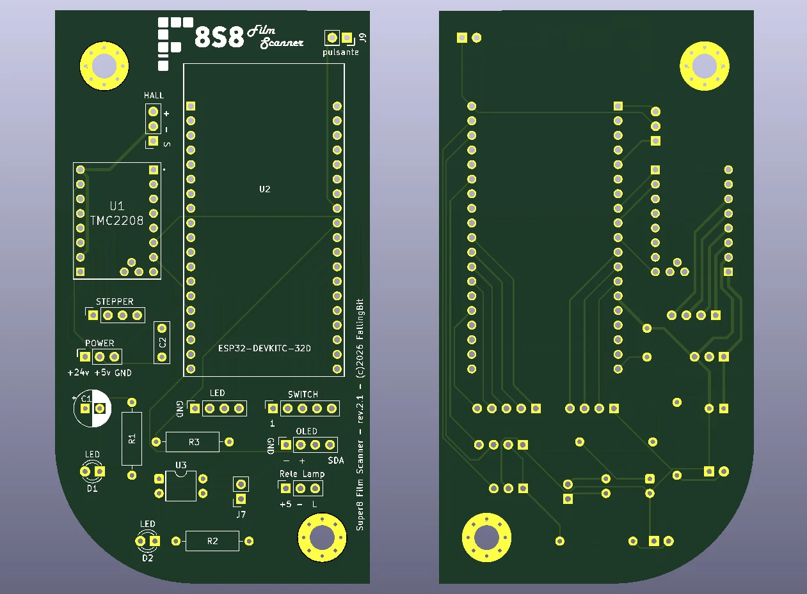

# Foto e immagini

| | |
|---|---|
|  |  |
| **Il proiettore** Silma Bivox "D" Lux modificato, visto da davanti: display OLED, led MOTOR / LAMP / GRAB, manopola dei comandi. | **Pannello frontale** con la schermata «LAMP» (lampada accesa per inquadrare e mettere a fuoco). Il led LAMP è acceso e il led GRAB segnala il click. |
|  |  |
| **Prototipo del PCB** (versione vecchia): ESP32 AZDelivery, driver BigTreeTech TMC2208 V3.0 con dissipatore, connettori per Hall, motore, alimentazione, relé e OLED. I due fili bianchi sono i collegamenti volanti di MS1 e MS2. | **Motore** NEMA 17 fissato con un supporto stampato in 3D e una fascetta; una cinghia lo collega alla puleggia della meccanica originale. |
|  |  |
| **Selettore rotante originale** della manopola: i suoi contatti sono letti dall'ESP32 per riconoscere le posizioni. | **Sensore Hall** in un supporto stampato in 3D vicino alla ruota dello shutter, dove è incollato il magnete. |

## Pannello LED

| | |
|---|---|
|  |  |
| **Pannello LED** autocostruito: una striscia LED a 12 V, 4000 K, tagliata in quattro pezzi corti affiancati su una basetta millefori. | **Pannello acceso** con davanti il diffusore di opalina (o plexiglass opaco). C'è molta aria intorno ai led e il pannello non scalda. |

## Giuntatrice

Giuntatrice a nastro **3M 702 Super 8 Splicer** (New Matrix) usata per riparare le giunture della pellicola prima della
scansione.

## Bobine e giunzione del LEAD

| | | |
|---|---|---|
|  |  |  |
| **Bobina da 12 cm**. | **Bobina da 7 cm**. | **Giunzione** di un LEAD bianco con la pellicola nella giuntatrice, prima della scansione. |

Nota: sul PCB del prototipo la serigrafia dei connettori di alimentazione dice «+12v», ma è una scritta del primo
progetto: oggi il motore è alimentato a 24 V (vedi [`../hardware/README.md`](../hardware/README.md)).

## PCB rev. 2.1

Fronte (a sinistra) e retro con le piste (a destra), anteprima da KiCad.
