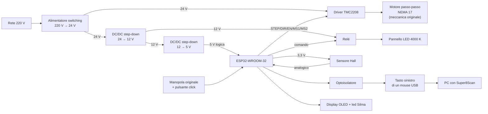

# Hardware

Il proiettore usato è un **Silma Bivox "D" Lux** (Super8 e Normal8), ma qualsiasi proiettore con meccanica
a griffa e shutter a ruota si può adattare allo stesso modo.

> **Schema e PCB aggiornati (rev. 2.1)**: i file KiCad e i gerber in [`PCB Scanner/`](PCB%20Scanner) corrispondono
> allo scanner, con alimentazione del motore a 24 V e MS1/MS2 del TMC2208 collegati all'ESP32.

Le foto del prototipo sono in [`../docs/`](../docs/README.md): mostrano la **prima versione** del PCB (serigrafia
«+12v» e fili volanti per MS1/MS2), non la rev. 2.1.

## Componenti principali

Elenco di quanto usato nel prototipo (i componenti sono tutti comuni e facili da trovare).

| Componente | Modello / valore | Note |
|---|---|---|
| Proiettore | Silma Bivox "D" Lux | Super8 e Normal8 |
| Scheda di controllo | **AZDelivery ESP32-WROOM-32** | DevKit C, modulo ESP32-WROOM-32 |
| Driver del motore | **BigTreeTech TMC2208 V3.0** | con dissipatore |
| Motore | NEMA 17 **17HS13-0404S** | 0,4 A per fase; Vref del TMC2208 regolato a circa 0,58 V (≈ 0,4 A) |
| Sensore di posizione | sensore Hall **lineare ratiometrico** a 3 pin, alimentato a 3,3 V; probabilmente Allegro **A1304** (da confermare: marcature `555G` e `1150`). Va bene qualsiasi sensore con le stesse caratteristiche (vedi sotto) | con magnete sulla ruota dello shutter |
| Optoisolatore | **PC817**, led interno con resistenza da **1 kΩ** | pilotato dal pin 18 dell'ESP32 (3,3 V); simula il click del tasto sinistro del mouse |
| Relé | modulo relé a 1 canale, 5 V, con led di stato (tipo JQC-3F-05VDC-C, 10 A) | accende e spegne il pannello LED (contatti a 12 V) |
| Convertitori DC/DC | 2 moduli step-down **LM2596** regolabili | uno regolato a 12 V, uno a 5 V |
| Display | modulo OLED 0,91", 128×32, **SSD1306**, I2C (0x3C) | |
| Led di tensione sul PCB | 1 rosso (24 V) con resistenza da 1,8 kΩ; 1 verde (5 V) con resistenza da 330 Ω | |
| Led del pannello frontale | 3 led comuni: rosso, verde, blu, con resistenze da 330 Ω | quelli del pannello originale Silma |
| Condensatori | 100 µF 50 V elettrolitico sui 24 V; 100 nF ceramico sui 5 V | filtro dell'alimentazione |
| Illuminazione | striscia LED a 12 V, 4000 K, tagliata in quattro pezzi corti affiancati | con diffusore di opalina (o plexiglass opaco) |
| Alimentatore | switching 220 V → 24 V | |

## Schema a blocchi

## Alimentazione

| Tratto | Tensione | Note |
|---|---|---|
| Alimentatore switching | 220 V → **24 V** | unico collegamento alla rete |
| Motore (pin VM del TMC2208) | 24 V | |
| DC/DC step-down n. 1 | 24 → 12 V | alimenta il pannello LED, passando dal relé, e il secondo convertitore |
| DC/DC step-down n. 2 | 12 → 5 V | logica (ESP32) |
| ESP32 (scheda di controllo) | 5 V | pin 5 V / VIN della scheda |
| Modulo relé | 5 V | ingresso pilotato dal pin 23 dell'ESP32 (3,3 V) |
| Display OLED | 5 V | collegato all'I2C dell'ESP32 |
| Sensore Hall | 3,3 V | dal regolatore di bordo dell'ESP32 |

Il relé, pilotato dall'ESP32, funziona da interruttore dei 12 V del pannello LED.

Nota sul display: nel prototipo il modulo OLED è alimentato a 5 V e SDA/SCL, misurati verso massa, restano a 3,3 V
(il modulo ha le pull-up sul lato a 3,3 V). Con un altro modulo, prima di collegarlo a 5 V, misura SDA e SCL:
se leggi circa 5 V alimentalo a 3,3 V, perché i pin dell'ESP32 non tollerano i 5 V.

## Modifiche al proiettore

- **Lampada**: tolta la lampada alogena dicroica. Al suo posto un mini-pannello a LED autocostruito a **4000 K**
  (luce neutra): una striscia LED a 12 V tagliata in quattro pezzi più corti, affiancati su una basetta
  millefori, con davanti un diffusore di opalina (o plexiglass opaco) che elimina il tipico punto luminoso al centro
  della proiezione. I led sono distanziati e c'è molta aria intorno: il pannello **non scalda** (vedi le foto in
  [`docs/`](../docs/README.md#pannello-led)).
  Il pannello è alimentato dal convertitore a 12 V tramite il relé.
- **Gate (finestra)**: modificato per la massima apertura, così si riprende **tutto il fotogramma senza crop**;
  nell'immagine si vede anche il foro della pellicola.
- **Motore**: stepper NEMA 17 con driver **TMC2208**; fa girare la meccanica originale (caricamento e avanzamento).
  Nel primo PCB i piedini **MS1 e MS2** del driver erano fissati con un ponticello fatto con le piste, quindi il
  passo non si poteva cambiare. Nel prototipo sono stati scollegati e collegati con due **fili volanti** ai pin
  **13 (MS1) e 15 (MS2)** dell'ESP32, così il firmware sceglie i microstep (ora 1/2 di passo) e si ottiene una
  velocità del motore maggiore. Nel PCB rev. 2.1 queste due connessioni sono già sulle piste.
- **Sensore di posizione**: magnete incollato sulla ruota dello shutter, in corrispondenza del "fotogramma pronto",
  letto da un sensore Hall a 3 pin montato in un supporto stampato in 3D. Il modello esatto non è certo: probabilmente
  un Allegro **A1304** (sensore lineare per 3,3 V), ma le marcature sul componente (`555G` e `1150`) non lo confermano.
  Quello che conta sono le sue caratteristiche, misurate con il tester sul prototipo:
  - sensore **lineare ratiometrico** alimentato a 3,3 V (dal regolatore dell'ESP32);
  - uscita a riposo, lontano dal magnete: **1,6 V** (circa metà dell'alimentazione);
  - uscita vicino al magnete: **1,2 V** (la tensione scende al passaggio del magnete).

  Un sensore equivalente con queste caratteristiche funziona. Il firmware legge l'uscita con l'ingresso analogico
  dell'ESP32 e due soglie (vedi il README del firmware): con un altro sensore o un altro magnete le soglie vanno
  ritarate.
- **Click del mouse**: un piccolo mouse USB smontato, alimentato dal **suo cavo USB direttamente dal PC** e visto
  dal PC come un normale mouse. Due fili sono saldati in parallelo al contatto del **tasto sinistro**:
  vanno ai pin del **PC817** lato transistor, **pin 4 (collettore) sul segnale** del tasto e **pin 3 (emettitore)
  sulla massa del mouse**. Il led interno (pin 1 e 2) è pilotato dall'ESP32 tramite la resistenza da 1 kΩ
  (pin 1 verso l'ESP32, pin 2 a massa).
  Quando l'ESP32 accende il led, il transistor chiude il contatto come un dito sul tasto. Il PC817 isola
  elettricamente il proiettore dal PC: i due circuiti non hanno nessun collegamento in comune.
  Il puntatore va posizionato sulla finestra di Super8Scan prima di iniziare.
- **Manopola e led**: usati la manopola e il pannello originali Silma (3 led di segnalazione), più un piccolo
  display OLED 128×32.
- **Normal8**: il proiettore ha un comando per passare tra Super8 e Normal8. Il formato del foro della pellicola
  cambia e andrà gestito nel controllo dei fotogrammi del software (da fare).

## PCB (rev. 2.1)

Cartella [`PCB Scanner/`](PCB%20Scanner): progetto KiCad (`Super8 PCB.kicad_pro`, `.kicad_sch`, `.kicad_pcb`) e
file di produzione (`S8Gerber/` e `S8Gerber.zip`). Immagine del circuito (fronte e retro):
[`docs/foto/PCB.webp`](../docs/foto/PCB.webp). La scheda ESP32 e il modulo TMC2208 si infilano sul PCB; il resto sono
connettori a pin.

| Connettore / parte | Collegamento | Pin ESP32 |
|---|---|---|
| POWER | +24 V, +5 V, GND | alimenta il motore (24 V), la logica e l'ESP32 (5 V) |
| STEPPER | 4 fili del motore | via TMC2208 |
| TMC2208 | DIR, STEP, EN | 33, 25, 26 |
| TMC2208 | MS1, MS2 (microstep) | 13, 15 |
| HALL | segnale (S), GND, +3,3 V | 34 (nessuna resistenza di pull-up sul PCB) |
| SWITCH | 5 contatti della manopola | 5, 17, 16, 4, 2 |
| LED | GND + 3 led (MOTOR, LAMP, GRAB) con resistenza da 330 Ω | 27, 14, 12 |
| Rele Lamp | +5 V, GND, comando | 23 |
| Mouse click (J7) | pin 3 e 4 del PC817 (lato transistor) | led del PC817 da pin 18, con resistenza da 1 kΩ |
| pulsante (J9) | pulsante che abilita/disabilita il click, tra il pin 2 e la massa | 19 (pull-up interna dell'ESP32) |
| OLED | GND, +5 V, SCL, SDA | 22 (SCL), 21 (SDA) |
| LED 24 V / LED 5 V | led rosso con 1,8 kΩ / verde con 330 Ω | |
| C1 / C2 | 100 µF sui 24 V / 100 nF sui 5 V | |

## Sicurezza

Questo è un progetto hobbistico: chi lo riproduce lo fa a proprio rischio e l'autore declina ogni
responsabilità (vedi le [avvertenze nel README principale](../README.md#avvertenze-ed-esclusione-di-responsabilità)).

- L'alimentatore lavora a **tensione di rete (220 V)**: monta l'alimentatore in un contenitore chiuso, con fusibile
  e senza parti sotto tensione accessibili. Se non hai esperienza con la rete elettrica, usa un alimentatore
  esterno già certificato (adattatore 24 V).
- Nel prototipo **non c'è nessun fusibile**. Chi costruisce il proprio scanner farebbe bene a metterne uno sulla
  linea a 24 V, dopo l'alimentatore.
- Il motore a 24 V e le parti in movimento del proiettore: spegni sempre prima di mettere le mani nel meccanismo.
- I due convertitori **LM2596** sono regolabili: **regola e misura con il tester le tensioni di uscita (12 V e 5 V)
  prima di collegare ESP32, relé e display**. Una tensione sbagliata sulla logica a 5 V può danneggiarli.
- **STACCA L'ALIMENTAZIONE DEL PROIETTORE PRIMA DI COLLEGARE L'ESP32 ALLA USB DEL PC.** Per programmare l'ESP32 con
  il cavo USB l'alimentatore del proiettore va scollegato. La scheda dell'autore ha un diodo che impedisce il ritorno
  di corrente tra le due alimentazioni, ma altre schede potrebbero non averlo: alimentarle insieme dal convertitore e
  dalla porta USB può danneggiare la scheda o la porta del PC.
- A valle dell'alimentatore le tensioni sono basse (24 V), ma un cortocircuito può comunque scaldare e danneggiare
  cavi e componenti: controlla i collegamenti prima di dare tensione.
